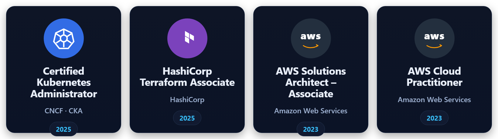

# Karam Hussain

**DevOps / Cloud & Platform Engineer** — AWS · Azure · GCP · Kubernetes · Terraform · DevSecOps · AI / LLM

📍 Islamabad, Pakistan &nbsp;·&nbsp; 🔗 [LinkedIn](https://www.linkedin.com/in/karam-hussain-b2282a3a7) &nbsp;·&nbsp; ✉️ iqbalkaram44@gmail.com

---

## 🌟 Summary

DevOps / Cloud & Platform Engineer with **6+ years** of experience in cloud infrastructure, automation, platform engineering and DevSecOps. Specialized in **AWS, Azure and GCP** with strong expertise in **CI/CD pipelines, Infrastructure as Code (Terraform)** and cloud security — including shift-left controls such as **SAST/DAST, secret scanning, OIDC and RBAC**. Experienced in designing scalable, secure and compliant architectures (**HIPAA, SOC 2, GDPR, ISO 27001, NIST**), hybrid networking with **site-to-site and point-to-site VPN**, and **FinOps** initiatives that cut cloud spend by up to **50%**. Have managed **RAG, LangChain and LLM-based AI** projects and **blockchain** workloads end to end, with hands-on work across enterprise migrations, observability, multi-cloud environments, client-facing delivery, and **110+ freelance projects all rated 5 stars**.

---

## 📜 Certified In

  

Certified Kubernetes Administrator (CKA, 2025) · HashiCorp Terraform Associate (2025) · AWS Solutions Architect Associate (2023) · AWS Cloud Practitioner (2023) · Kubernetes Labs — KodeKloud (2024)

---

## 💼 Experience

### 🧭 Tech Lead — DevOps / Cloud Engineer · Troon Technologies
*Jun 2026 – Present*
- Manage deployments and day-to-day production across multiple **AWS** projects — owning releases, incident handling and production change management.
- Enforced mandatory CI/CD security gates — **SAST**, dependency vulnerability scanning and secret detection (**Semgrep, Gitleaks, Trivy, SonarQube, Codacy**) — so vulnerable packages and leaked credentials can't reach servers or services.
- Moved all secrets and environment configuration into **Azure Key Vault** and **AWS Secrets Manager**, removing hard-coded credentials from code and pipelines.
- Enforced **RBAC** and keyless **OIDC** authentication in GitHub Actions for AWS and Azure deployments, replacing long-lived cloud credentials.
- Manage multi-environment deployments (dev / staging / production) with controlled promotion and rollback paths.
- Built monitoring and observability with **Azure Monitor, Log Analytics, Application Insights** and **AWS CloudWatch**, with alerts triaged into critical / non-critical routing.
- Designed and operated **site-to-site and point-to-site VPN** with private endpoints for a medical healthcare client, keeping production databases off the public internet.
- Administered Azure: **Container Apps, App Service, Azure SQL, ACR, Azure Functions, Storage Accounts, Azure DNS, VNets, and VPN/Application Gateways**.
- Built **Azure DevOps** pipelines and applied **Azure RBAC** least-privilege across resource groups; hardened against **Microsoft Defender for Cloud** recommendations in line with **NIST**.
- Client-facing: gathered requirements, presented architecture and change plans, and wrote SOPs and client setup guides.

### 🏗️ DevOps Engineer & Solution Architect (Contract) · Codora
*May 2025 – May 2026*
- Owned the complete **AWS** infrastructure for a **blockchain** application, with least-privilege IAM and all keys/secrets in **AWS Secrets Manager** vaults.
- Managed all infrastructure as code with **Terraform**, via a dedicated CI/CD pipeline for infra changes (plan → review → approval before apply).
- Added mandatory pipeline security to every service: **Semgrep** (SAST), **Gitleaks** (secret scanning), **Codacy** (quality) and **DAST**.
- Set up uptime monitoring and incident alerting with **Better Stack (Better Uptime)**.
- Acted as **Solution Architect** for a **RAG- and LLM-based AI assistant built on LangChain**, and owned its deployment end to end.
- Led **FinOps** across several projects, cutting cloud costs by almost **50%** through rightsizing, scheduling non-prod resources, storage lifecycle policies and commitment-based pricing.
- Platform engineering: reusable **Terraform modules** and standardized pipeline templates for teams to self-serve.
- Earned **CKA** and **HashiCorp Terraform Associate** during the engagement.

### ☁️ DevOps / Cloud Engineer · Cloudelligent
*Apr 2024 – Apr 2025*
- Designed and maintained enterprise **CI/CD** pipelines using **Jenkins** and **GitHub Actions** for microservices and containerized workloads.
- Implemented **GitOps** with **Kubernetes (EKS), Helm** and **ArgoCD** for automated deployments.
- Managed container platforms: **Docker, Kubernetes (EKS/AKS), ECS, ECR** across production.
- Automated provisioning with **Terraform** and **Ansible** across AWS and Azure multi-account setups.
- Administered AWS/Azure: EC2, EKS, ECS, S3, EFS, VPC, AKS, VNets, Load Balancers.
- DevSecOps: IAM, Azure RBAC, Secrets Manager, Key Vault, SAST/DAST.
- Observability with **Prometheus, Grafana, ELK, CloudWatch, Azure Monitor**.
- Led enterprise **on-premises → AWS/Azure migrations**; enforced **GDPR, SOC 2, HIPAA, NIST**.
- Designed secure networking (VPC, VNet, subnets, routing, gateways) and **hybrid identity** with **Active Directory + Azure Entra ID**.

### 🚀 DevOps Engineer — Junior → Associate → Senior · K2X Tech
*Jan 2022 – Mar 2024*

**Senior DevOps Engineer** *(Oct 2023 – Mar 2024)*
- Led DevOps architecture for production-grade, high-availability **AWS** systems.
- Advanced CI/CD (Jenkins, GitHub Actions, Ansible); DevSecOps (IAM, container hardening, SAST/DAST).
- Compliance-ready architectures aligned with **SOC 2, HIPAA, GDPR, ISO**; centralized observability (Prometheus, Grafana, ELK, CloudWatch).
- Optimized infrastructure for scalability, cost and performance; mentored junior engineers.

**Associate DevOps Engineer** *(Dec 2022 – Sep 2023)*
- Built scalable AWS architectures (EC2, Auto Scaling Groups, Elastic Beanstalk, VPC).
- Developed **Terraform** ECS clusters integrated with **EFS**; automated provisioning with Terraform + Ansible.
- Designed **MLOps** pipelines with **MLflow** and **DVC** for model tracking and reproducibility.
- Managed Docker microservices on ECS; administered **Proxmox** virtualization with network segmentation.

**Junior DevOps Engineer** *(Jan 2022 – Nov 2022)*
- Deployed and maintained AWS apps (EC2, S3, VPC); assisted building CI/CD (Jenkins, GitHub Actions).
- Managed **MySQL, PostgreSQL and MongoDB**; supported Linux administration and production troubleshooting.
- Basic monitoring with CloudWatch; worked with **Proxmox** for lab/staging.

### 💻 Freelance DevOps / Cloud Engineer · Fiverr
*Dec 2020 – Dec 2021*
- **110+ projects, every one rated 5 stars.** Kubernetes on **AKS/GKE** with Docker + Helm.
- Provisioned Azure/GCP infra (VMs, networks, load balancers, storage, IAM); CI/CD with GitHub Actions, Jenkins, Azure DevOps.
- NIST-aligned security + docs; Terraform, Bash and Python automation; Linux, Nginx, SSL, DNS.

### 🎓 AWS Solution Architect Intern · Contour Software
*Jan 2021 – Mar 2021*
- AWS cloud architecture design and optimization; hands-on Terraform, Docker, Linux; cost optimization.

---

## 🛠️ Featured Projects

### 🤖 ChatGeniee — Multi-Tenant AI SaaS (RAG + LLM)
Built and operate end to end. **RAG + LLM pipeline** (document ingestion, embeddings, pgvector search, grounded answers) with **LangChain** on **AWS Bedrock**; **Next.js / React** frontend, **Node.js / TypeScript + Python / Flask** backend, **PostgreSQL / pgvector**, embeddable widget; multi-tenant isolation, Dockerized on **AWS** with CI/CD and monitoring.

### 🧠 RAG / LLM AI Assistant (LangChain)
Solution-architected and deployed a RAG- and LLM-based AI assistant on **LangChain**, owning deployment end to end.

### ⛓️ Blockchain Application Infrastructure (AWS)
Owned the full AWS infrastructure for a blockchain application — least-privilege IAM, Terraform IaC, and a gated CI/CD pipeline.

---

## 🎓 Education

**B.Sc. Computer Science** — University of Engineering & Technology (UET) · 2021 · GPA 3.04 / 4.0

---

## 🧰 Skills

- **Cloud Platforms:** AWS (EC2, ECS, EKS, S3, EFS, VPC, CloudFront, Lambda) · Azure (AKS, VMs, VNet, Load Balancer, App Services, Container Apps, Functions, ACR, Azure SQL, Storage Accounts, DNS, VPN/Application Gateways, Entra ID, Key Vault, Azure Monitor) · GCP (GKE, Compute Engine, VPC)
- **DevOps Tools:** Jenkins · GitHub Actions · Azure DevOps · ArgoCD · AWS CodePipeline · Helm · GitOps
- **Infrastructure as Code:** Terraform (reusable modules, IaC CI/CD pipelines) · Ansible
- **Containers & Orchestration:** Docker · Kubernetes (EKS, AKS, GKE) · ECS · ECR · ACR
- **Monitoring & Logging:** Prometheus · Grafana · ELK Stack · AWS CloudWatch · Azure Monitor · Log Analytics · Application Insights · Better Stack (Better Uptime)
- **Security & DevSecOps:** IAM · Azure RBAC · OIDC · Secrets Manager · Key Vault · SAST (Semgrep, Codacy) · Secret Scanning (Gitleaks) · DAST · Container Security · Microsoft Defender for Cloud
- **Compliance:** HIPAA · SOC 2 · GDPR · ISO/IEC 27001 · NIST
- **AI & LLM:** RAG · LangChain · LLM Application Deployment · AI Agents · Solution Architecture
- **FinOps & Platform Engineering:** Cloud Cost Optimization · Rightsizing · Internal Platform Tooling · Pipeline Templates
- **Blockchain:** Blockchain Application Infrastructure on AWS
- **Databases:** MySQL · PostgreSQL · MongoDB · Azure SQL · Redis
- **MLOps:** MLflow · DVC
- **Virtualization:** Proxmox · Hypervisors
- **Full-Stack:** React · Next.js · Node.js · TypeScript · Python (FastAPI, Flask, Django)
- **Networking:** VPC · VNet · Subnets · Load Balancing · Site-to-Site VPN · Point-to-Site VPN · Private Endpoints · DNS · Routing
- **Programming:** Python · Bash · JavaScript / TypeScript · PHP · C#
- **Others:** Linux · Active Directory · Azure Entra ID · API Gateway · Auto Scaling · System Design · Client-Facing Delivery
